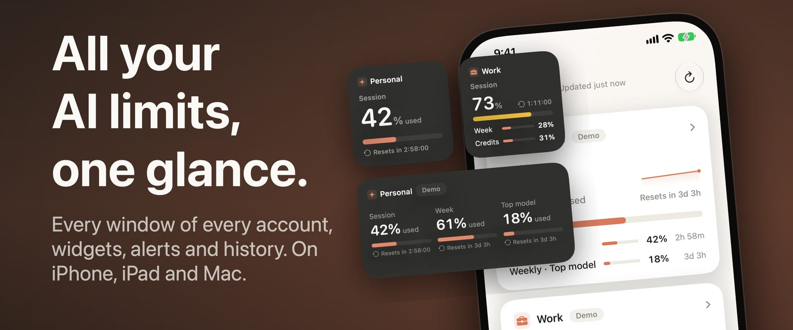
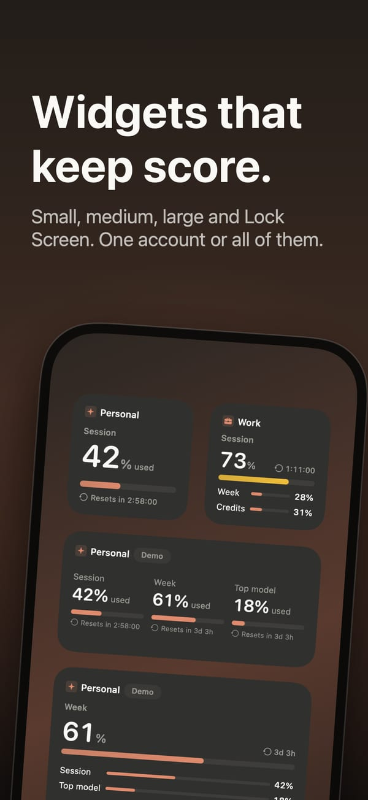
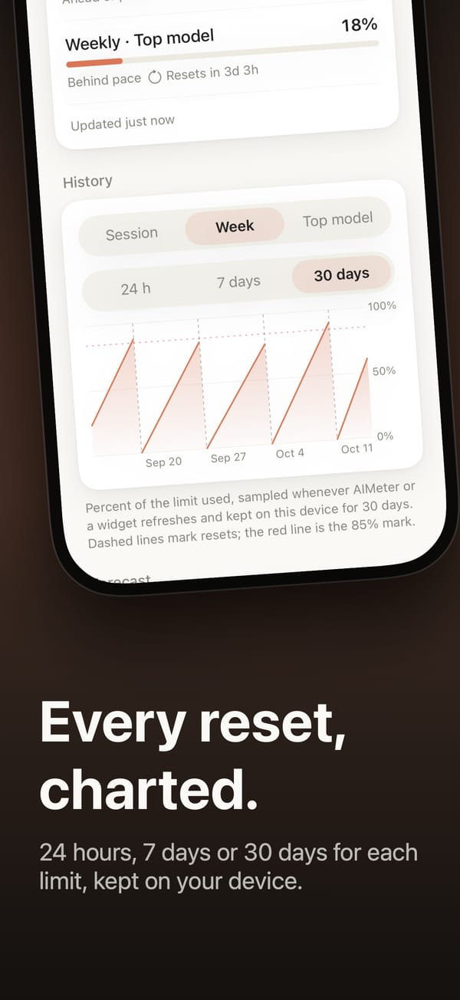
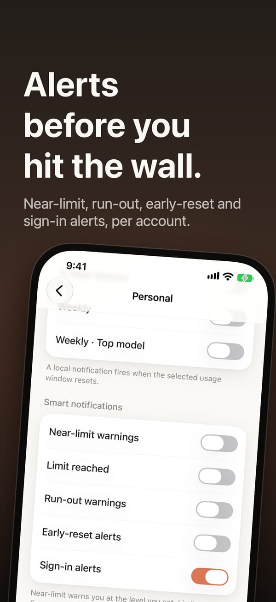
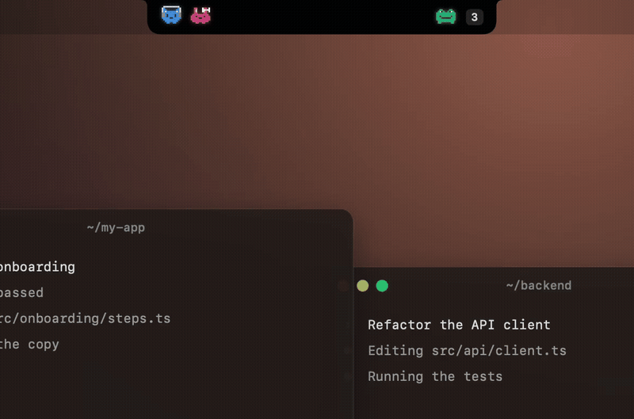

<p align="center">
  <a href="https://mikealvarado.github.io/AIMeter/"></a>
</p>

# AIMeter

Your AI limits, at a glance: how much of your subscription is left and when
each window resets, on iPhone, iPad, Mac and Apple Watch. Free, open source,
no server, no account.

**[Website](https://mikealvarado.github.io/AIMeter/)** · [Privacy policy](https://mikealvarado.github.io/AIMeter/privacy/) · [Support](https://mikealvarado.github.io/AIMeter/support/)

**[Download on the App Store](https://apps.apple.com/app/id6797946742)** (iPhone, iPad, Apple Watch) ·
**[Download for Mac](https://github.com/MikeAlvarado/AIMeter/releases/latest/download/AIMeter-macOS.zip)** (macOS 14+, notarized, updates itself)

Supported today: **Claude** Pro and Max (the session, weekly and
per-model windows), **Codex** on any ChatGPT plan, Free included (its
5-hour and weekly windows, or Free's one monthly window), and **GitHub
Copilot** Free, Pro and Pro+ (the monthly chat, completion and
premium-request quotas). The architecture is provider-agnostic, so more
can follow.

## What it does

<p align="center">
  
  
  
</p>

- **Every limit, and when it resets.** One card per account with its
  session, weekly and per-model windows as bars, a plan badge, a live
  countdown to each reset and a small 24-hour sparkline. Terracotta,
  yellow past 70 %, red past 85 %, the same on every screen.
- **Widgets.** Home Screen, Lock Screen, Notification Center and the Mac
  desktop: one account's limits, a single number (a bar or a ring), or
  every account at once (two in full, or six condensed). Countdowns tick
  live, and on iOS the widgets refresh themselves. In StandBy a small
  widget turns into one large figure, readable across the room.
- **A control.** On iOS 18, one account's figure in Control Center, on
  the Lock Screen or on the Action button; a tap refreshes it.
- **iPad and iPhone Duo.** Two or more accounts in two columns of cards
  of one width and height; on iPhone Duo, Settings and Refresh in the bar
  at the side of the screen, like the rest of the app's buttons.
- **History and forecast.** Thirty days of each limit on a chart with its
  resets marked, pace captions, a forecast of what runs out early, and an
  export to CSV or JSON.
- **Alerts, off by default.** A reminder at each reset, a warning near a
  limit and one at it, run-out warnings from your recent pace, early
  resets, and the one that starts on: a sign-in that stopped working,
  with "Sign in again" right on the card.
- **Apple Watch.** An app and complications showing what the iPhone last
  fetched. The Watch never holds a login.
- **Live Activity.** An account's session countdown on the Lock Screen and
  the Dynamic Island, with its pet if you like. Opt-in, per account.
- **Several accounts, three services.** Claude, Codex and GitHub
  Copilot side by side, personal and work, each with its own name, icon
  and alerts. Drag to reorder, or let the one closest to a limit come
  first.
- **A tour, what's new, and updates.** The first launch walks through each
  feature; after an update a short sheet says what changed; the Mac app
  updates itself from this repository's releases.
- **Eight languages**: English, Spanish, German, French, Japanese, Korean,
  Brazilian Portuguese and Simplified Chinese.

### On the Mac

<p align="center">
  
</p>

- **The notch.** A black island fused to the MacBook's notch, or one it
  draws on any other screen: hover for the figures you chose, click for
  every account in full, never taking focus. Each Claude Code session at
  work gets a pixel pet beside the notch that walks, shakes when it needs
  your permission and sleeps when done; open the island to see what it is
  doing step by step ("Step 3 of 7" when the desktop app keeps a plan),
  open it in the right copy of Claude, and, if you turn it on, approve,
  deny or stop it from there.
- **Menu bar.** A gauge, a number, a bar, a battery or several windows,
  with an optional countdown and the account's name; a popover with
  every account; a discreet mode for a screen others can see.
- **Claude Code on this Mac.** What your sessions would have cost at API
  list prices, from the CLI's own logs, opt-in; only the usage fields are
  read, and nothing leaves the Mac.

## How it connects

- **Claude on the Mac**: zero setup for the first account. AIMeter reads
  the login Claude Code already keeps on your Mac, read-only, and never
  touches it; Claude Code keeps owning its own token refresh.
- **Claude on iPhone and iPad, and every Claude account after the first on
  the Mac**: tap **Add account** and pick Claude. AIMeter opens Claude's sign-in page in your browser (the
  same PKCE flow Claude Code uses, any sign-in method works), you paste
  back the code it shows, and the app keeps its own token in the
  Keychain, refreshing it itself. On the Mac the same field also accepts
  the credentials JSON copied from another Mac; the iOS build accepts
  nothing but the sign-in code.
- **Codex**: pick Codex under **Add account**. AIMeter shows a one-time
  code, you enter it on ChatGPT's device page in your browser (the same
  device-code sign-in the Codex CLI offers; it has to be allowed under
  ChatGPT's security settings), and the account connects as soon as you
  approve. On the Mac, one click reads the login the Codex CLI keeps in
  `~/.codex` instead, read-only.
- **GitHub Copilot**: the same kind of code, entered on GitHub's device
  page. AIMeter asks GitHub for no scope at all.
- **Sign-in recovery**: Claude and OpenAI rotate the refresh token on
  every use, so a login shared with another client can stop working. AIMeter says so on
  the card, notifies you once, and offers **Sign in again**, which repairs
  the account in place: history, alerts and placed widgets all survive.

## Privacy and data

Everything in this section can be checked against the code. The full
policy is on the [website](https://mikealvarado.github.io/AIMeter/privacy/).

- **What leaves your device**: HTTPS requests to the services you
  connected. Claude: `api.anthropic.com` (`/api/oauth/usage` for the
  windows and spend, `/api/oauth/profile` for the plan name, at most
  every 6 hours) and, when you sign in through the app, the standard
  OAuth exchange with `claude.ai` and `console.anthropic.com`. Codex:
  `chatgpt.com` (`/backend-api/wham/usage`) and `auth.openai.com` (the
  device-code sign-in and the token refresh). GitHub Copilot:
  `github.com` (the device-code sign-in, no scope) and `api.github.com`
  (the Copilot quota endpoint, whose answer carries your user id). One
  anonymous GET of each connected service's public status page
  (`status.claude.com`, `status.openai.com`, `www.githubstatus.com`, off
  with "Check service status"); on the Mac, once a day, `api.github.com` for a newer release
  and its download (off with "Check for updates automatically"); and,
  only with "Sync preferences and history" on, your display preferences
  and each account's history to your own iCloud, never the logins.
  Nothing else: no analytics, no crash reporting, no third-party SDKs,
  no server of ours.
- **What is stored, and where**: tokens in the device Keychain only
  (shared with the iOS widget through the App Group's keychain access
  group, never on the Watch); the last snapshot and your preferences in
  the App Group container; up to 30 days of percentages per window as a
  small file per account, deleted when you disconnect.
- **Read-only on the Mac**: a login Claude Code or the Codex CLI already
  keeps is only read, never changed or rotated.
- **Opt-in on the Mac**: reading Claude Code's logs in `~/.claude/projects`
  for the cost figures (only the usage fields, never a prompt or a
  reply); the Claude Code sessions in the notch read only each record's
  type, time and ids and the names of the tools Claude calls, and the
  optional hooks add one entry per event to `~/.claude/settings.json`,
  backed up first, posting to a socket only AIMeter can read; answering
  from the island, off by default, shows what a permission prompt asks
  about only while it is open; "Avoid covering the menu bar" asks for Accessibility
  and uses it for one thing, reading where the menu titles and status
  items are; "Open at Login" registers with macOS only when you turn it
  on.
- **Notifications** are made on the device from the reset dates already
  in the snapshot. No push service.
- **Audit it**: `Scripts/probe-usage-endpoint.sh` prints the exact JSON
  the app reads with your own login (the token is never printed or
  written), `Scripts/probe-codex-usage.sh` and
  `Scripts/probe-copilot-quota.sh` do the same for Codex and Copilot
  (identifiers redacted), `Scripts/probe-status-endpoint.sh` the status
  page, and
  `Scripts/probe-claude-code-logs.sh` which fields of the logs are
  looked at.

## Disclaimer

AIMeter reads usage from **undocumented endpoints**: the one Claude Code
reads (`https://api.anthropic.com/api/oauth/usage`), the one the Codex
CLI's `/status` reads (`https://chatgpt.com/backend-api/wham/usage`) and
the one Copilot's editor plug-ins read
(`https://api.github.com/copilot_internal/user`), each with your own
token for that service. They may change or disappear at any time and
their use is not officially supported.

This project is **not affiliated with, endorsed by, or sponsored by
Anthropic, OpenAI or GitHub**. "Claude" is a trademark of Anthropic, PBC;
"ChatGPT", "Codex" and "OpenAI" of OpenAI; "GitHub" and "Copilot" of
GitHub, Inc. Use at your own risk and in accordance with each service's
terms.

AIMeter's own sign-in requests a single OAuth scope, `user:profile`, the
one the usage and profile endpoints need, and never `user:inference`, so a
token issued to AIMeter cannot be used to run Claude. Anthropic's
published authentication policy (Claude Code docs → Legal and compliance →
"Authentication and credential use") reserves Claude.ai OAuth for its own
applications and disallows third-party apps from collecting or storing
Claude.ai credentials. AIMeter is a read-only meter of your own account
that holds nothing but the token you grant it, on your device, but it
claims no exemption from that policy, and Anthropic may restrict this
endpoint or these tokens at any time.

## Building

You need Xcode 16+ and an Apple Developer account (a free one works for
running on your own devices).

1. Clone the repo and open `AIMeter.xcodeproj`.
2. Copy `Config.local.xcconfig.example` to `Config.local.xcconfig` (already
   gitignored) and set `DEVELOPMENT_TEAM` to your own Team ID. Every
   target reads it from there.
3. If your team can't use the bundle identifiers as-is, change
   `com.mikealvarado.aimeter`, `com.mikealvarado.aimeter.widgets`, the
   Watch's `…aimeter.watchkitapp` / `…watchkitapp.widgets`, and the App
   Group `group.com.mikealvarado.aimeter` to your own. The App Group must
   match in **every** target's entitlements and in `Shared/AppConfig.swift`.
4. Build and run the `AIMeter` scheme.

The macOS app is intentionally **not sandboxed** (it reads Claude Code's
credentials); its widget extension is, and only reads what the app writes
to the App Group. Signing (any team) is required for the App Group to
work at runtime.

Tests: `swift test` in `Packages/UsageKit`, and the app's own
`AIMeterTests` from Xcode (⌘U) or
`xcodebuild test -project AIMeter.xcodeproj -scheme AIMeter -destination 'platform=macOS'`.

### Releasing

iOS ships through App Store Connect (archive the `AIMeter` scheme for iOS
in Release, export with the `app-store-connect` method, submit; the
`Info.plist` declares `ITSAppUsesNonExemptEncryption` false). The Mac app
ships as a Developer ID-signed, notarized zip on a GitHub Release:
`Scripts/release-mac.sh <version>` archives, notarizes through the Apple
account Xcode is signed in to (no certificate to create, no `notarytool`
profile), verifies the result and zips it as `AIMeter-macOS.zip`, the
name every release keeps so the download link and the Mac's updater never
change. Before either: bump `MARKETING_VERSION`, add the version's notes
to `AIMeter/WhatsNew.json` in all eight languages (the script checks),
and tag the commit with exactly that version.

## Architecture

```
Packages/UsageKit      provider-agnostic Swift Package (no UI imports)
  Core/                UsageProvider protocol, UsageSnapshot, UsageWindow
  Providers/Claude/    each service's endpoint- and sign-in-specific code,
  Providers/Codex/     isolated, with its own CLAUDE.md
  Providers/Copilot/
  Storage/             Keychain wrapper + App Group snapshot store +
                       AccountRegistryStore (the list of connected logins)
AIMeter/                multiplatform SwiftUI app (iOS + macOS);
                        Views/NotchIsland/ is the macOS notch island,
                        Services/Updates/ the Mac's own updater,
                        WhatsNew.json each release's notes (8 languages),
                        Views/Tour/ the first launch's tour
AIMeterWidgets/         AIMeterUsage (one account's limits), AIMeterSingleUsage
                        (one number), AIMeterAllAccounts (every account),
                        and the Live Activity (iOS)
WidgetsShared/          what both widget extensions compile: the account
                        picker intent, the accessory views, placeholders
AIMeterWatch/           the Watch app; AIMeterWatchWidgets/ its complications
Shared/                 config and presentation helpers used by app and
                        widgets, PrivacyInfo.xcprivacy, the notch island's
                        pure model and geometry (unit-tested)
Scripts/                the release script, the endpoint probes, and the
                        renderers for the app icons (AppIcon/), the
                        store assets (StoreFrames/), the island videos
                        (IslandVideo/) and the pets (PetsPreview/)
site/                   the website (product page, privacy policy, support;
                        React + Vite), deployed to GitHub Pages from main
```

Each of `AIMeter/`, `AIMeterWidgets/`, `AIMeterWatch/`, the three
`Packages/UsageKit/Sources/UsageKit/Providers/*/` folders,
`Scripts/StoreFrames/` and `site/` has its own `CLAUDE.md` with that folder's detail; the
repo-root `CLAUDE.md` is the full spec that ties them together.

Adding a provider = implementing `UsageProvider` (one folder under
`Providers/`), returning `UsageWindow`s with an extensible `kind`
(`.session`, `.weekly`, `.modelSpecific("…")`, `.quota("…")`) and their
own `duration`, plus one case each in `Shared/ProviderCatalog.swift`
(display name, picker glyph, which credential store backs an account of
that family, its status page), a `ProviderLogin` case and a Connect view
for its sign-in. Widgets render whatever windows a snapshot contains.

## Acknowledgments

The notch island owes its feel to three projects that got there first.
[boring.notch](https://github.com/TheBoredTeam/boring.notch) (GPL-3.0)
was the reference for *how* a notch panel should move: a fixed window
that never resizes, the black slab sized by its own content, one spring
carrying size, corners and shadow together. It was read, not copied:
AIMeter's island is its own implementation, written from scratch under
this repository's MIT license, and no boring.notch code is in this tree.
Vibe Island set the one-line format the island shows
(`5h 42% 2h 58m | 7d 61% 3d 3h`) and the way it shows a Claude Code
session while collapsed: its pets at one end, the count at the other.
[Atoll](https://github.com/Ebullioscopic/Atoll) (GPL-3.0) showed which
options a screen without a notch needs, the pill like the iPhone's
island, its height, hiding until the cursor comes, staying out of screen
captures, and was studied the same way: read, never copied. Thanks to
all three.

## License

[MIT](LICENSE)
